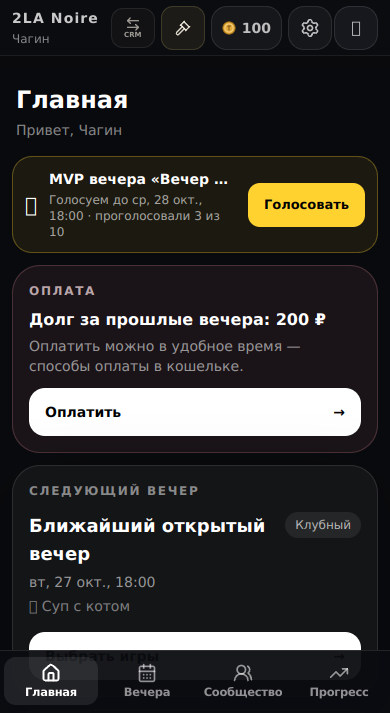
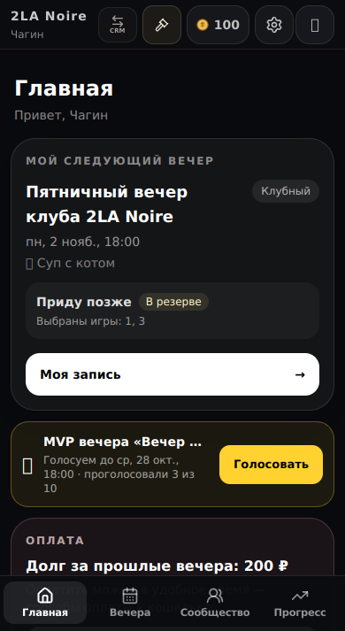
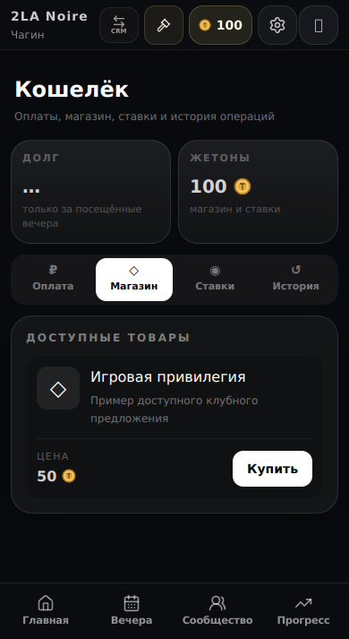
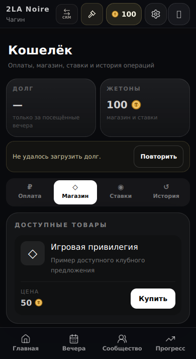

# Application continuity — mobile evidence

Synthetic fixtures, Chromium 133, 390 × 713 CSS px, fixed time 26 October 2026 18:00 Moscow. Same route, viewport and initial scroll position for each pair. Baseline components: main `2be2d7d`. Candidate: `feat/player-personal-evening-and-resume`; exact revision is the commit containing this evidence. Source UI was built with the same isolated preview harness. Additional 360 px captures and focused navigation/retry checks were inspected locally; PR mobile CI provides fresh exact-head evidence.

| Scenario | Before | After |
| --- | --- | --- |
| Home: a nearer invitation and a later personal reservation |  |  |
| Wallet Shop: payment-summary request fails |  |  |

The Home card now prioritizes the player's booking and precedes general reminders, so the vertical content order intentionally changes. Wallet errors offer retry without stretching one balance card. These are screenshots of genuine mounted components, not generated or retouched images. Local headless fonts may differ from Telegram on a phone.
