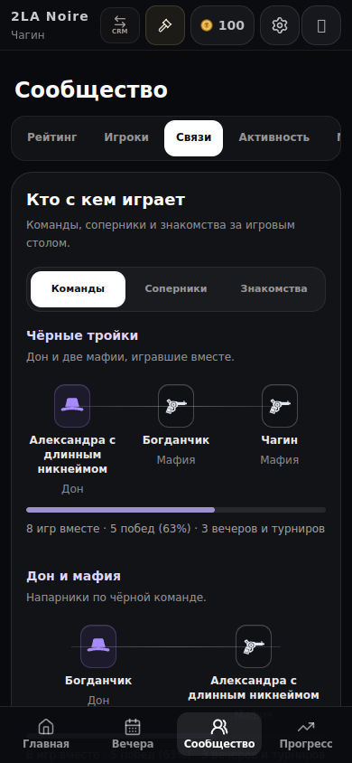
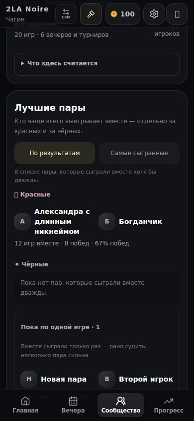
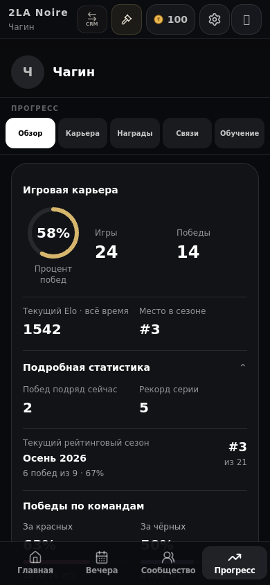
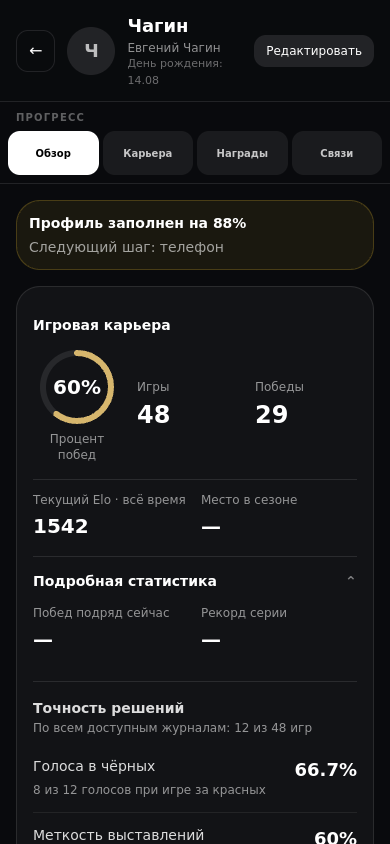
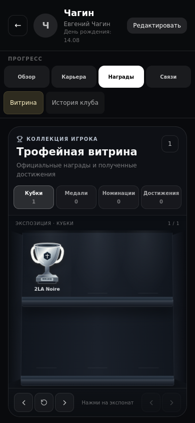
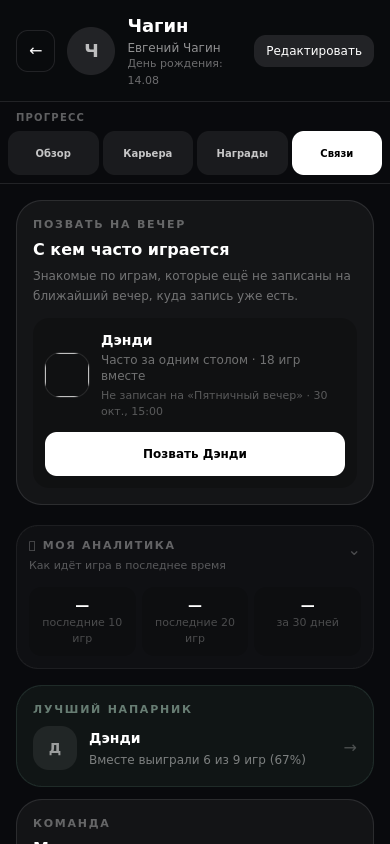
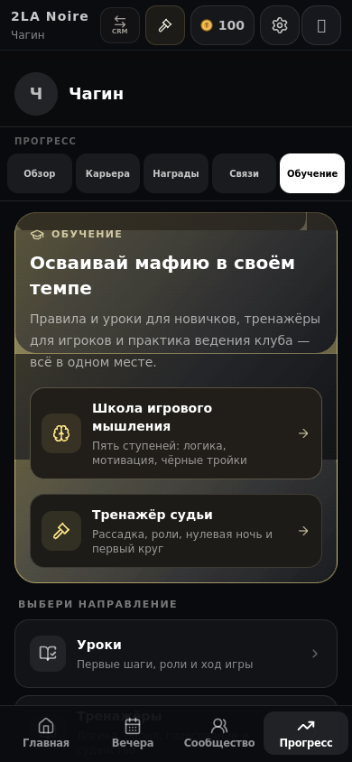
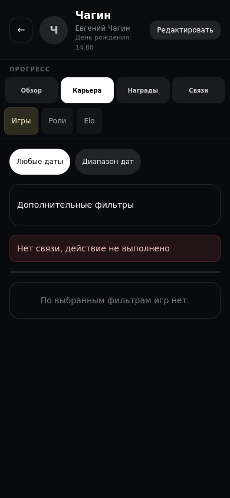

# Свидетельства анализа

Источник интерфейса: сохранённый изолированный preview дерева #1065, эквивалентного main5a69c78. Новые компоненты/исправления не подставлялись.390×844, синтетические данные. Снимки показывают текущее состояние, не макеты «после».

[Полный разбор и план](../../UX_COMMUNITY_PROGRESS_REVIEW_2026-10-27.md). `states.json` —24 открытых состояния и извлечённые заголовки/текст; не все они визуально просмотрены. Из25 снимков просмотрены14; здесь сохранены8 показательных. `proof.json` —3 дополнительных поведенческих наблюдения.

| Состояние | Снимок |
| --- | --- |
| Клубные связи |  |
| Пары ниже историй |  |
| Прогресс в кабинете,5 вкладок |  |
| Детальный профильный стенд,4 вкладки |  |
| Награды |  |
| Личные связи |  |
| Обучение в Прогрессе |  |
| Ошибка одновременно с «игр нет» |  |

Поведенческие наблюдения: выбор «Роли» не меняет адрес и после обновления возвращается Обзор; искусственный GET503 списка игр показывает ошибку вместе с пустым результатом; искусственный PATCH503 закрепления награды выполнен стендом один раз, но его ошибка в UI не показана. Настоящих серверных записей/сообщений нет.

«Показатели» не имеет наполненного ответа в кабинетном стенде; это пробел fixture, а не доказательство дефекта production. Полный App с авторизацией и Telegram-клиент не проверялись. Состав/порядок CSS отдельного стенда может отличаться от полного App; наблюдение градиентных слоёв в обучении оставлено как вопрос для проверки.
