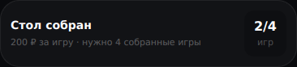
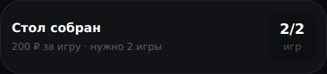
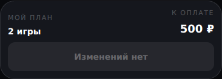
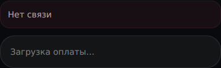
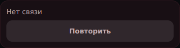

# Current booking and payment usability

Actual mounted components, synthetic data, Chromium 133, 390 × 740 CSS px, fixed time 27 October 2026 12:00 Moscow. Baseline source: main `35ced0f`; after: this PR's candidate. Each pair uses the same route, API fixture, viewport and scroll alignment; images are direct component captures, not generated or retouched. Normal phone navigation remains outside these component excerpts.

| Existing scenario | Before | After |
| --- | --- | --- |
| Novice gathering: API requires two ready games |  |  |
| Rating plan: two selected games, one 500 ₽ entry |  |  |
| Failed payment-detail read |  |  |

No prices or gathering rules were changed. The booking screen now uses the existing server facts and shared pricing rule. Additional focused browser flows check 360/390 px, save failure/retry, controls while a save is pending, and detail/payment read recovery.
