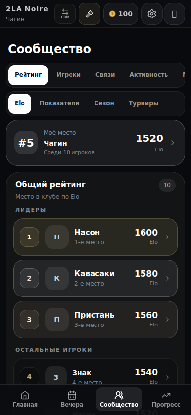
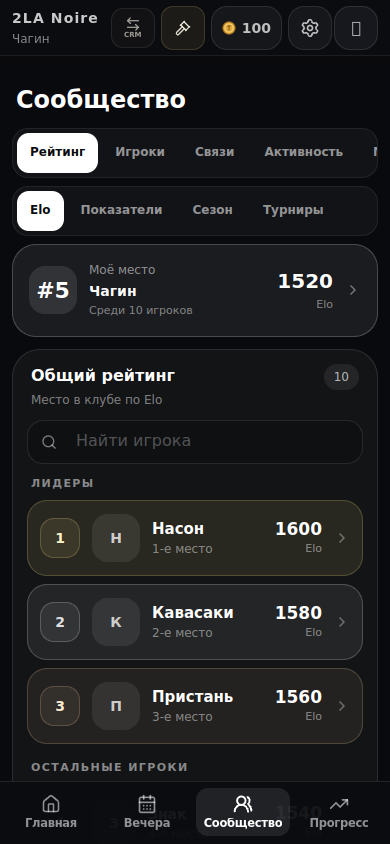
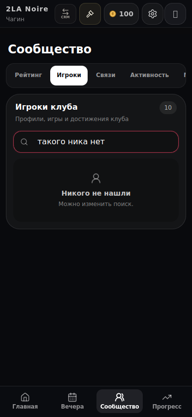
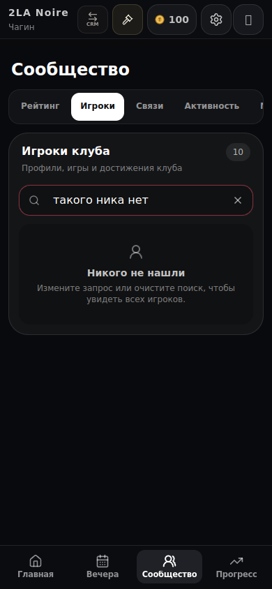
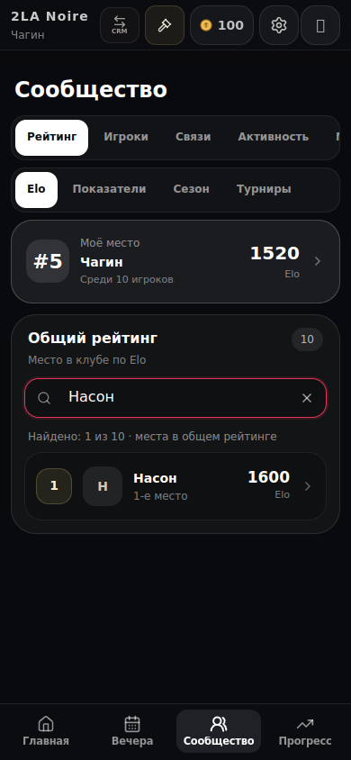

# Поиск игроков — 27.10.2026

База: main d290066. Исходники затронутых страниц совпадают с сохранённой сборкой предпросмотра #1060; сравнение использует эту сборку и текущий кандидат. Маршруты `/player/rating` и `/player/club`, одинаковые синтетические данные, 390×844, время 27.10.2026 15:00 МСК. Это изолированный предпросмотр, не данные или проверка production.

В Elo добавлен поиск по нику. Он показывает реальные места и Elo исходного рейтинга, количество совпадений и отдельное состояние отсутствия результатов. Собственное место остаётся видимым. Очистка возвращает исходные группы лидеров/остальных игроков без повторного запроса. В каталоге игроков добавлены такая же очистка и понятный выход из пустого поиска. Поле получает фокус после очистки.

| Состояние | До | После |
| --- | --- | --- |
| Общий рейтинг |  |  |
| Игрок не найден |  |  |

Результат нового поиска: .

Проверено: девять компонентных тестов двух затронутых страниц; точное место/Elo найденного игрока, отсутствие совпадений и сброс в браузере; очистка каталога; размер кнопки 44×44, сохранение фокуса и отсутствие горизонтальной прокрутки при360/390×480. Уменьшенная высота моделирует доступную область, но не является проверкой системной клавиатуры. Все пять снимков просмотрены. Никаких изменений правил начисления и серверных данных.
