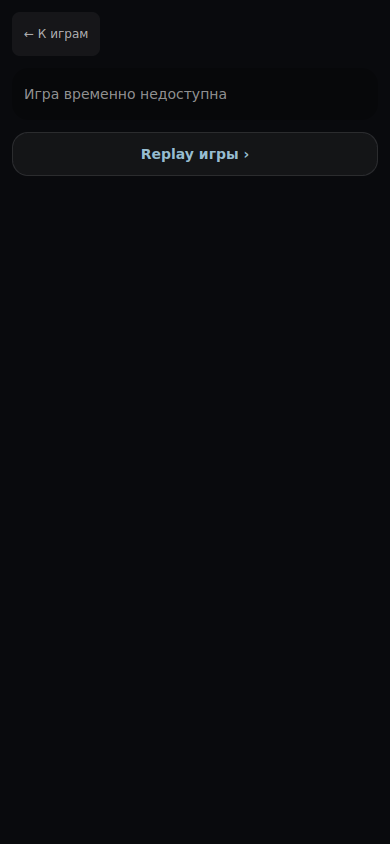
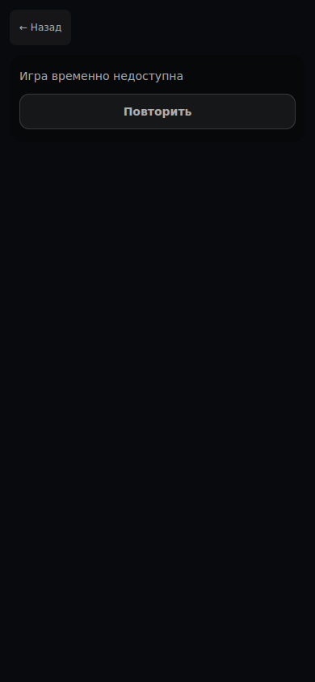
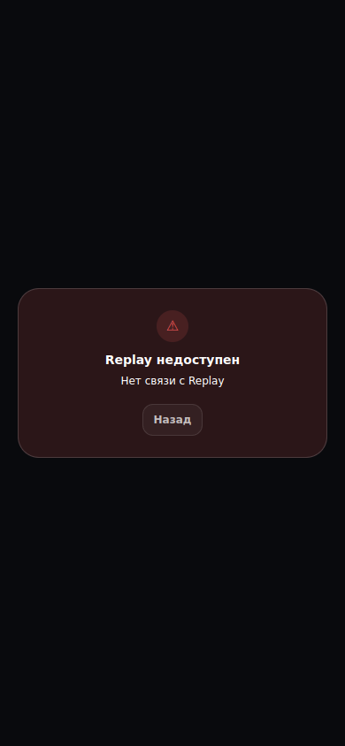
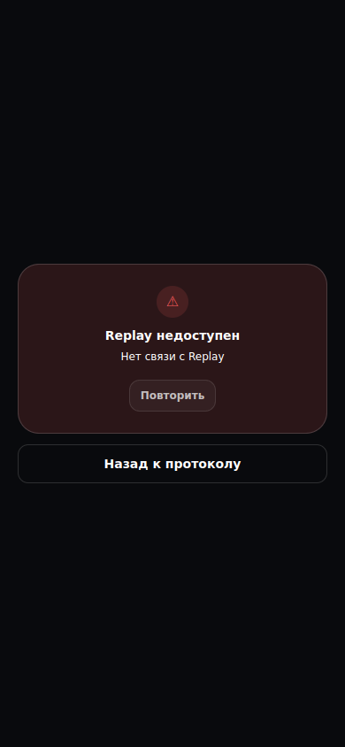
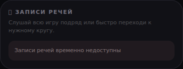
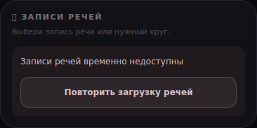
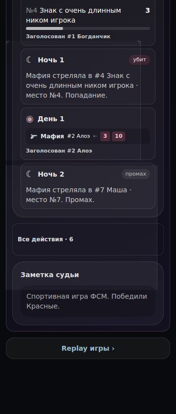
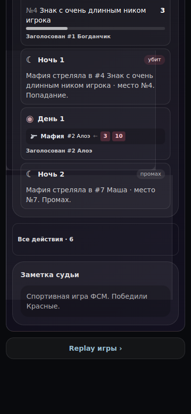

# Результат игры и Replay: восстановление — 27.10.2026

База: main9cd619c. Три прежних компонента (PlayerGameDetail, PlayerHistoryStatsView, PlayerReplayScreen) из исходников базы подставлены в тот же новый стенд для снимков «до». Данные и исходные состояния одинаковы. Снимки ошибок:390×844, речи — снимок соответствующего раздела. Дополнительно проверен возврат при360/390×844.

Стенд воспроизводит замену результата на Replay и обратный переход браузера с размонтированием/созданием компонентов. Это настоящие компоненты и native Back, но не весь App с авторизацией. Синтетическая игра, журнал и GET503 не являются production-данными. Дополнительные методы записи и настоящие сообщения не вызываются.

| Состояние | До | После |
| --- | --- | --- |
| Не загрузилась игра |  |  |
| Не загрузился Replay |  |  |
| Не загрузились речи |  |  |

Теперь повторяется соответствующий GET. Отдельная ошибка речей не сбрасывает выбранный шаг повтора. Кнопка Replay появляется после загрузки результата; подпись Back не обещает другой экран. Текст записей описывает отдельный выбор речи/круга.

Перед Replay в исходной записи истории сохраняются раскрытые разделы и прокрутка. У мобильного стенда прокручивается #root, а window.scrollY остаётся нулём; проверка поэтому требует ненулевого смещения контейнера и сравнивает все сохранённые позиции. После Back восстанавливаются подробный протокол, выбранный игрок и положение страницы. Другая игра не наследует раскрытия.

| Возврат360px | Возврат390px |
| --- | --- |
|  |  |

Проверки:22 различных компонентных теста в четырёх файлах; после исправления вложенной прокрутки повторены затронутые13. Release audit/dependency guard, TypeScript и lint изменённых исходников. Два новых коротких браузерных сценария добавлены в существующий preview spec; локально соответствующие действия выполнены через Playwright. Все восемь снимков просмотрены. Общий игровой набор вручную не запускался.

В этом блоке реализованы F01–F05 из UX_RESULT_FLOW_REVIEW_2026-10-27.md. F06–F08 (сезон, текст авторазбора, переход из карточки матча) остаются следующими. Формулы, приватность и игровые протоколы не переписывались.
