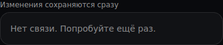
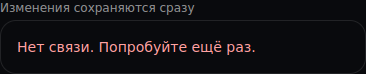
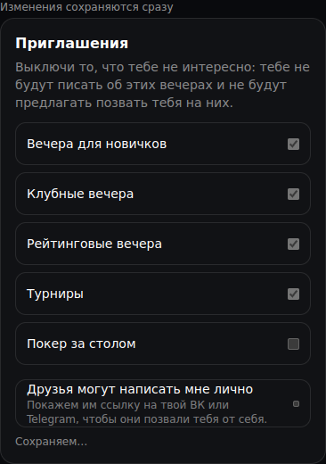
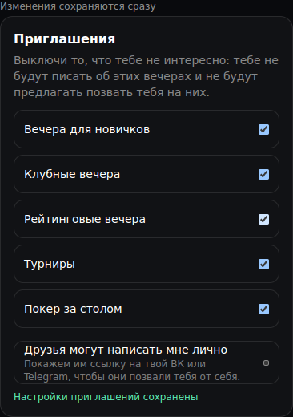

# Настройки: повтор загрузки и подтверждение — 27.10.2026

База: main de4b03b (#1062). Сохранённая сборка предпросмотра #1062 содержит те же исходники настроек. Одинаковый маршрут `/player/settings`, синтетические данные, ширина390px, высота844px. Общая обёртка стенда имитирует один GET503 для каждой группы и задержанное PUT-сохранение приглашений; настоящие запросы и сообщения не отправляются. На снимках — соответствующий раздел страницы без редактирования изображения.

| Ситуация | До | После |
| --- | --- | --- |
| Приглашения: ошибка загрузки |  |  |
| Приватность: ошибка загрузки |  |  |

| Сохранение приглашений | Ответ сервера получен |
| --- | --- |
|  |  |

Девять компонентных тестов в трёх файлах покрывают повтор GET без перезагрузки, блокировку параллельной записи приватности, использование подтверждённого сервером состояния, откат неуспешной правки и состояния сохранения приглашений. Проверки безопасности релиза, зависимостей, типов и lint изменённых файлов прошли. Браузер: повтор загрузки всех трёх групп, приглашения до/после ответа, кнопка44px и отсутствие горизонтальной прокрутки при360/390px. Все шесть снимков просмотрены.

Это проверка изолированного интерфейса; production, правила приватности, получатели и маршрутизация уведомлений не менялись.
