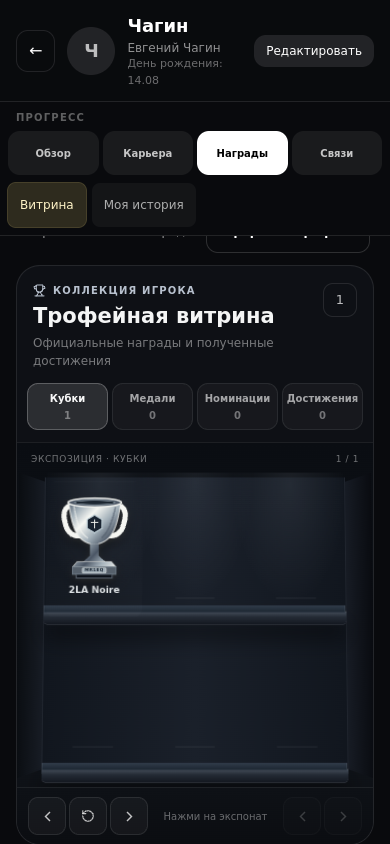
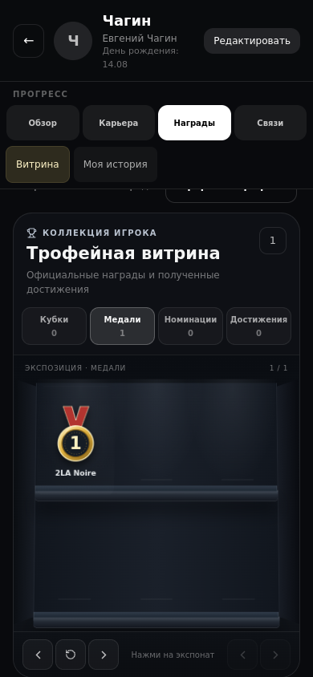

# Club follow-ups — implementation evidence

Four requested changes form one candidate based on current main. Rules and working assumptions are recorded in [BUSINESS_RULES](../../BUSINESS_RULES.md); release state belongs to [PROJECT_STATE](../../PROJECT_STATE.md).

| Finding | Result and acceptance evidence |
| --- | --- |
| CF01: scattered debts | One read-only balance per player across completed/settled evenings, including partial payments and extensions, excluding waivers. Telegram text and organizer tasks show the total and evening breakdown. Existing trigger/lookback windows remain, with one personal reminder per player within the existing 20-hour gap. Payment/reminder/order integration cases pass. |
| CF02: frozen birthday | Title derives from the occurrence date in the automation key using Moscow calendar days: future, tomorrow, today and overdue. Open task ID and postponed due date survive refresh; completed tasks stay completed. Helper/integrity/agenda checks pass. |
| CF03: tied MVP | Separate durable runoff among primary leaders, distinct ballots and callbacks, same state in app/bot/worker/posts/result cards. Stale-round/self/nonfinalist votes are rejected. Active runoffs remain visible ahead of newer closed evenings. HTTP tests exercise both app and bot entry points; original ballots survive. Already finalized historical results are preserved. |
| CF04: ordinary cups | Evening awards are medals; eligibility for cups is shared across cabinet, pins and timeline. Existing automatic MVP award kind changes in place: ID, source and pin positions survive. Real tournament cups remain cups. Award identity and cabinet checks pass. |

The unanswered clarification uses explicitly announced working defaults: one 24-hour runoff; another tie/no runoff votes goes to the existing organizer decision. These are implementation assumptions, not explicit owner answers.

Verification: 14 targeted Vitest files / 70 cases passed, followed by focused regression cases for postponed birthdays, app/bot runoff lifecycle, award identity/pins and the final lifecycle query. TypeScript and ESLint pass. Python transport/handler changes pass `py_compile`; pytest is unavailable locally, so Python unit execution is not claimed. Dependency/release checks are recorded in the PR. Required remote CI remains authoritative for the exact published head.

Eight browser cases passed, including six changed states at all four required sizes (360×640, 390×844, 1366×768, 1440×900), plus existing medal/tournament-cup previews. The unchanged detector reports 24 clean new-state audits; no threshold or exception change. Actual screenshots were inspected. The temporary local before-image server is not part of CI; CI uses the normal registered preview spec.

All data below are synthetic fixtures. No production database, real birthday (including Дина's), actual outgoing messages or deployed runtime were used/changed. Ledger mutations and historical result rewriting were not performed.

| Before: ordinary MVP cup | After: same award as medal |
| --- | --- |
|  |  |

Additional inspected evidence: [runoff](after-runoff.png), [aggregated debt and current birthday task](after-agenda.png).
